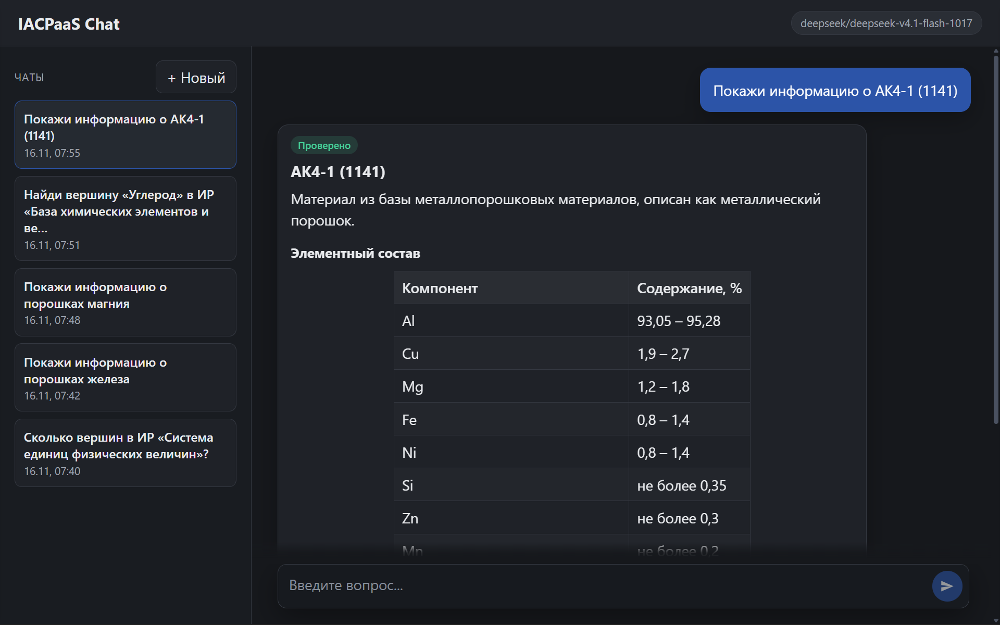

# IACPaaS MCP Agent

Учебный прототип: MCP-сервер для инфоресурсов IACPaaS и агент над ним.



## Общая информация

- Три типа агента: веб-чат, CLI и VS Code.
- MCP-сервер построен на FastMCP; для ИР доступно 14 тулзов.
- Агент использует LangGraph и LangChain, модель подключается через `ChatOpenAI`.
- Веб-чат работает на FastAPI и SQLite.
- Write-операции доступны только в веб-чате и CLI. VS Code работает read-only.

## Подготовка

Требуются Python 3.11+ и `uv`.

```powershell
uv sync
```

### Переменные окружения

Скопируйте шаблон и заполните `.env`:

```powershell
Copy-Item .env.example .env
```

`.env` не коммитится; переменные окружения имеют приоритет над файлом.

Для IACPaaS нужен один из вариантов:

- `IACPAAS_API_KEY` - специальный строковый ключ, получаемый у администратора;
- `IACPAAS_USERNAME` и `IACPAAS_PASSWORD` - JWT токен, получаемый при вызове метода signin:
    - адрес - `https://iacpaas.dvo.ru/api/signin`
    - тип запроса - POST запрос
    - в заголовок добавить Content-Type: application/json
    - данные запроса: JSON-строка вида `{"username":"...", "password":"..."}`, где вместо `"..."` указываются логин и пароль пользователя

Базовый URL захардкожен: `https://iacpaas.dvo.ru`.

Запись по умолчанию выключена. Включить: `IACPAAS_ALLOW_WRITE=true`. Preview-тулзы показывают план и ничего не меняют; apply вызывается после подтверждения.

Для агента обязательны:

- `IACPAAS_AGENT_API_KEY`;
- `IACPAAS_AGENT_MODEL`;
- `IACPAAS_AGENT_BASE_URL`.

Агент использует `ChatOpenAI`, `BASE_URL` должен быть OpenAI-совместимым.

Дополнительные параметры:

- `IACPAAS_AGENT_TEMPERATURE` - по умолчанию `0`; пустое значение отключает передачу;
- `IACPAAS_AGENT_REASONING_EFFORT` - по умолчанию пусто; пустое значение отключает передачу;
- `IACPAAS_AGENT_CONTEXT_TOKENS` - длина контекста модели в токенах, по умолчанию `1_000_000`.

### Каталог ресурсов

`catalog.txt` - локальный список доступных ИР: один путь на строку.

```text
# Ресурсы в «Мой Фонд»
Загрузки/Пример
```

`title` не хранится: он берется из последнего сегмента пути.
`list_inforesources` ищет по `title` и `path`. Чтение разрешено только для пути,
который есть в каталоге; импорт и удаление обновляют каталог автоматически.
Путь можно переопределить через `IACPAAS_CATALOG`.

## Запуск

### MCP-сервер вручную

Нужен только для отдельной проверки сервера или внешнего MCP-клиента. 
Для веб-чата, CLI и VS Code отдельно запускать MCP-сервер не нужно: они запускают
его сами.

```powershell
uv run iacpaas-mcp
```

HTTP-режим:

```powershell
uv run iacpaas-mcp --transport http
```

В VS Code сервер подхватывается из `.vscode/mcp.json`.

### CLI

```powershell
uv run iacpaas-agent "Сколько вершин в ИР «База металлопорошковых материалов»?"
```

При `IACPAAS_ALLOW_WRITE=true` CLI получает preview-тулзы, печатает план и
запрашивает подтверждение `[y/N]`; apply выполняется только после `y`.
Статусы выполнения печатаются в stderr, итоговый ответ - в stdout.
Если обязательная переменная не задана, агент завершится с ошибкой со списком
отсутствующих. Ответ проверяется валидатором; подробности - в
`docs/architecture.md`.

### Веб-чат

```powershell
uv run iacpaas-web
```

Адрес - `http://127.0.0.1:8000`. Слева - список чатов, справа - ответы, бейдж
проверки и источники. История и трасса вызовов хранятся в `data/chat.db`.
Статусы приходят потоком, ответ рендерится как безопасный Markdown.
Ответ проверяется валидатором.

Write-операции доступны при `IACPAAS_ALLOW_WRITE=true`. Агент вызывает preview-тулзы
и показывает карточку операции; apply вызывается веб-сервером после кнопки
«Подтвердить».

### VS Code

Откройте папку `IACPaaS-MCP-Agent`, выполните `uv sync` и выберите агента **IACPaaS**
в списке агентов чата. MCP-сервер подхватывается из `.vscode/mcp.json`,
инструкции лежат в `.github/agents/iacpaas.agent.md`.

В VS Code доступны read-only тулзы и `validate_answer`. Вызов `validate_answer`
зависит от соблюдения инструкций моделью и не гарантируется.

## Дополнительно

### Диагностика

```powershell
uv run iacpaas-mcp --version
```

Если VS Code не видит сервер, проверьте `.vscode/mcp.json` и Output канала
MCP/Copilot. Ошибки чтения приходят как `ErrorResult` с полем `kind`.

### Структура

- `src/iacpaas_mcp` - MCP-сервер;
- `src/iacpaas_agent` - LangGraph-агент и валидатор;
- `src/iacpaas_web` - браузерный чат на FastAPI и SQLite;
- `catalog.txt` - локальный каталог ресурсов для `list_inforesources`;
- `docs` - архитектура, сценарии и описание тулзов;
- `.vscode/mcp.json`, `.github/agents/iacpaas.agent.md` - режим VS Code.

### Документация

- `docs/architecture.md` - схема режимов, контекст и цикл агента;
- `docs/scenarios.md` - ручные сценарии проверки;
- `docs/tools-description.md` - MCP-тулзы, аргументы и операции IACPaaS.
