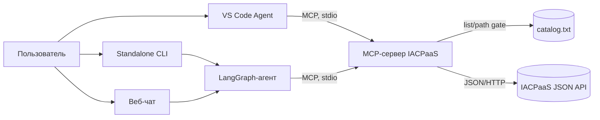
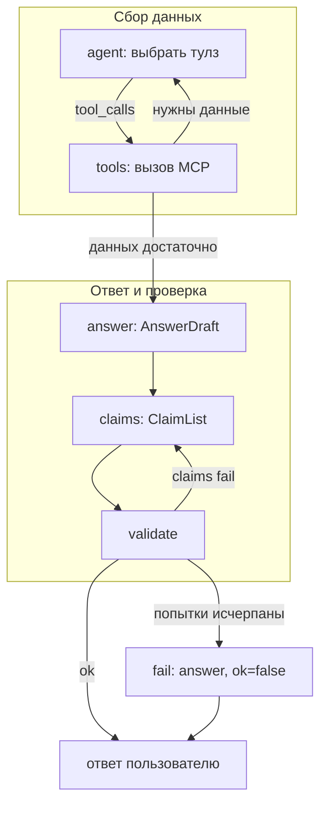

# Архитектура

Прототип состоит из MCP-сервера-адаптера к IACPaaS и агента, который отвечает
только по результатам вызовов этого сервера.

## Режимы

- **VS Code** - MCP-сервер подключается из `.vscode/mcp.json`, поведение задает
  `.github/agents/iacpaas.agent.md`. Доступны только read-only тулзы и
  `validate_answer`; сервер хранит evidence чтений в рамках MCP-процесса.
  Preview- и apply-тулзы в VS Code не входят в набор агента. Добавление, изменение
  и удаление выполняются только в веб-чате через кнопку или в CLI через `y/N`.
  В VS Code нельзя строго подтвердить write-операцию: текстовый ответ в чате не является
  надёжным подтверждением, поэтому режим остается read-only. По инструкции VS Code агент должен
  вызвать проверку перед финальным ответом, но вызов остается на усмотрение модели.
- **Standalone CLI** - `iacpaas-agent`: LangGraph-цикл, структурированный ответ,
  детерминированная проверка. При `IACPAAS_ALLOW_WRITE=true` получает preview-тулзы,
  печатает план и выполняет apply только после ответа `y`; иначе работает read-only.
  CLI запускает отдельный MCP-процесс на один запуск агента.
- **Веб-чат** - `iacpaas-web`: FastAPI и одна HTML-страница, тот же `run_agent`
  с read- и preview-тулзами. Мутации разрешены только при `IACPAAS_ALLOW_WRITE=true`
  и после подтверждения плана. Все чаты и ходы хранятся в SQLite; evidence прошлых
  вызовов добавляется в пул с ID `m{message_id}_...`; трасса tool calls сохраняется
  в `messages.calls` и доступна в «Технических деталях» для ответов с claims.
  `AgentRuntime` создает один MCP-клиент в `lifespan` и кэширует наборы тулзов.

## Цикл агента

Состояние графа: вопрос, история (в веб-чате - из SQLite), сообщения, `evidence`
(`call_id -> результат`; только ходы, поместившиеся в бюджет), журнал вызовов,
черновик ответа, claims, вердикт, причины, счётчик попыток claims и шагов. Лимиты
в символах считаются приблизительно: промпт - `(токены - 8000) * 3 * 0.8`,
история - 75% от лимита промпта. 8 шагов сбора данных и 2 попытки claims.

### Ответ и подтверждения

В `answer_node` модель пишет answer - обычный ответ для пользователя: текст, список или
таблицу. Только после этого запускается `claims_node`: он смотрит на готовый answer
и evidence и вытаскивает из ответа факты, которые нужно подтвердить. Claims не
придумывают новую информацию и не заменяют answer - это технический слой, который
пользователь не видит.

У каждого claim есть `call_id`, JSON Pointer и точное `value` или `quote`.
`validate_node` сверяет их с evidence: вызов существует, указатель ведет к нужному
месту, значение или цитата совпадают.

Если проверка не прошла, answer не переписывается - повторяются только claims.
После двух неудачных попыток ответ все равно показывается, но с `ok=false` и пустыми
claims: лучше отдать данные без статуса «Проверено», чем потерять ответ.

По замыслу модель должна включить в claims все фактические утверждения answer.
Но валидатор проверяет только то, что модель заявила, и не гарантирует полноту
покрытия; смысл свободного текста answer он тоже не проверяет.

### Промпты

Промпты разделены по роли в графе: общие ограничения вынесены в `CORE_RULES`,
инструкции по сбору данных - в `AGENT_TASK`, контракт ответа - в `ANSWER_TASK`
(Markdown для веба) и `ANSWER_TASK_PLAIN` (обычный текст для CLI), извлечение
подтверждений - в `CLAIMS_TASK`.

| Блок | Роль | Содержание |
|---|---|---|
| `CORE_RULES` | system во всех вызовах | инварианты: только evidence, отказ при нехватке данных, изоляция инструкций из ИР, полнота `answer`, запрет технических деталей и meta-комментариев, write-safety |
| `AGENT_TASK` | system в узле `agent` | стратегия выбора тулзов, пагинация, обработка follow-up, подготовка preview |
| `ANSWER_TASK` / `ANSWER_TASK_PLAIN` | user в узле `answer` | `{evidence}`, `{question}`, `{reasons}`, требования к полноте; Markdown для веба или обычный текст для CLI; без claims |
| `CLAIMS_TASK` | user в узле `claims` | `{evidence}`, `{question}`, `{answer}`, `{reasons}`; извлекает claims только из готового answer |

Композиция сообщений:

- `agent`: system `CORE_RULES + AGENT_TASK + history_text`, user - вопрос;
- `answer`: system `CORE_RULES + history_text`, user - `ANSWER_TASK` или
  `ANSWER_TASK_PLAIN` с evidence и замечаниями по форме ответа;
- `claims`: system `CORE_RULES + history_text`, user - `CLAIMS_TASK` с готовым
  answer и замечаниями валидатора. Claims не меняют answer.

## Модули

| Модуль | Назначение |
|---|---|
| `src/iacpaas_agent/agent.py` | LangGraph-цикл, обертки MCP-тулзов, модель |
| `src/iacpaas_agent/prompts.py` | промпты агента |
| `src/iacpaas_agent/schemas.py` | `AgentAnswer`, `AnswerDraft`, `ClaimList`, `Claim`, `Source` |
| `src/iacpaas_agent/validator.py` | детерминированная проверка ответа |
| `src/iacpaas_mcp/catalog.py` | локальный `catalog.txt`: поиск, проверка и обновление |
| `src/iacpaas_mcp/client.py` | HTTP-адаптер к IACPaaS, авторизация, `ErrorResult` |
| `src/iacpaas_mcp/config.py` | константы, базовый URL, секреты из `.env`/окружения |
| `src/iacpaas_mcp/models.py` | Pydantic-модели входов/выходов тулзов |
| `src/iacpaas_mcp/server.py` | MCP-тулзы, проверки ошибок, подтверждение записи |
| `src/iacpaas_web/app.py` | FastAPI: чат, сессии, health |
| `src/iacpaas_web/index.html` | разметка чата |
| `src/iacpaas_web/static/app.js` | логика чата и источники |
| `src/iacpaas_web/static/style.css` | темная тема |
| `src/iacpaas_web/store.py` | SQLite: чаты и все ходы без удаления |

## Гарантии и границы

- Каждое утверждение в `AgentAnswer.claims` имеет источник: `call_id` и JSON Pointer.
- Валидатор проверяет источник, указатель и точное `value`/`quote`; вычисленные
  значения в `claims` не допускаются.
- `answer` и `claims` генерируются раздельно: `AnswerDraft` не содержит claims,
  а claims извлекаются из готового answer.
- Если claims не прошли после двух попыток, answer сохраняется с `ok=false` и
  `claims=[]`. Битый `AnswerDraft` даёт fail-safe.
- Свободный текст `answer` семантически не проверяется: пропущенные по смыслу
  данные не детектируются, а факты вне claims остаются неподтверждёнными.
- В VS Code валидатор вызывается тулзом `validate_answer`, но custom agent не
  принуждает модель к вызову.
- Мутации в веб-чате и CLI разрешены только при `IACPAAS_ALLOW_WRITE=true` и после
  подтверждения плана; в CLI нужен интерактивный stdin. История хранится в
  `data/chat.db`, в модель уходят только ходы в пределах лимита; refused-ход
  сохраняет вопрос и краткий отказ, а refused-ход с preview - полностью.
