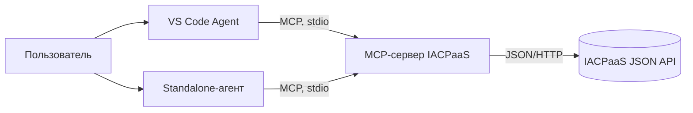
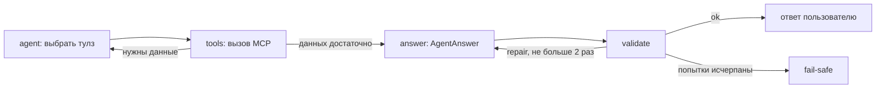

# Архитектура

Прототип состоит из MCP-сервера-адаптера к IACPaaS и агента, который отвечает
только по результатам вызовов этого сервера.

## Два режима

- **VS Code** — MCP-сервер подключается из `.vscode/mcp.json`, поведение задаёт
  `.github/agents/iacpaas.agent.md`. Доступны только read-only тулзы.
- **Standalone** — `iacpaas-agent`: LangGraph-цикл, структурированный ответ,
  детерминированная проверка, трасса и replay.

## Цикл standalone-агента

Состояние графа: вопрос, сообщения, `evidence` (`call_id -> результат`), журнал
вызовов, ответ, вердикт, число попыток и шагов. Лимиты: 8 шагов сбора данных,
3 попытки ответа (первичная и две починки).

## Модули

| Модуль | Назначение |
|---|---|
| `src/iacpaas_mcp/server.py` | MCP-тулзы, проверки ошибок, каталог, подтверждение записи |
| `src/iacpaas_mcp/client.py` | HTTP-адаптер к IACPaaS, авторизация, `ErrorResult` |
| `src/iacpaas_mcp/models.py` | Pydantic-модели входов/выходов тулзов |
| `src/iacpaas_mcp/config.py` | константы, базовый URL и секреты из окружения |
| `src/iacpaas_agent/agent.py` | LangGraph-цикл, обёртки MCP-тулзов, модель |
| `src/iacpaas_agent/schemas.py` | `AgentAnswer`, `Claim`, `Source` |
| `src/iacpaas_agent/validator.py` | детерминированная проверка ответа |
| `src/iacpaas_agent/trace.py` | запись JSONL и replay без сети |
| `src/iacpaas_agent/prompts.py` | промпты и `PROMPT_VERSION` |

## Гарантии и границы

- Каждое утверждение в `AgentAnswer.claims` имеет источник: `call_id` и JSON Pointer.
- Валидатор проверяет существование источника, указателя, значения, формулу и
  отсутствие ответа без вызовов тулзов.
- `temperature=0` снижает разброс, но гарантию даёт только валидатор.
- «Без внутренних знаний» означает: нет подтверждённого источника — нет утверждения
  в `claims`. Свободный текст `answer` валидатором не проверяется.
- В режиме VS Code детерминированного валидатора нет: там работают только
  инструкции агенту и read-only набор тулзов.
- Сжатие ответов и автотесты отложены до v2.
