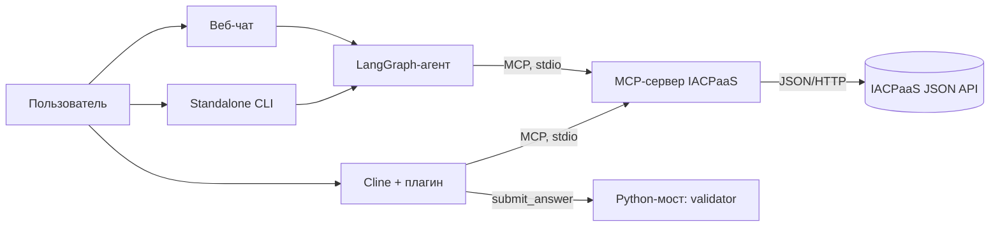
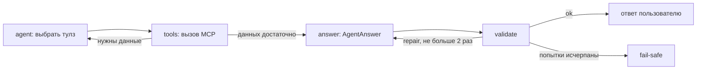

# Архитектура

Прототип состоит из MCP-сервера-адаптера к IACPaaS и агента, который отвечает
только по результатам вызовов этого сервера.

## Режимы

- **VS Code, Cline** - плагин `.cline/plugins/iacpaas-spike` регистрирует MCP-сервер,
  правило и `submit_answer` с `completesRun`. Модель вызывает read-only тулзы,
  `afterTool` добавляет `call_id`, `submit_answer` проверяет ответ через
  `iacpaas_agent.bridge`. `submit_and_exit` и write-тулзы блокируются.
- **Standalone CLI** - `iacpaas-agent`: LangGraph-цикл, структурированный ответ,
  детерминированная проверка.
- **Веб-чат** - `iacpaas-web`: FastAPI и одна HTML-страница, тот же `run_agent`
  в read-only режиме. Все чаты и ходы хранятся в SQLite; evidence прошлых вызовов
  добавляется в пул с ID `m{message_id}_...`.

## Цикл агента

Состояние графа: вопрос, история из SQLite, сообщения, `evidence` (`call_id -> результат`;
только ходы, поместившиеся в бюджет), журнал вызовов, ответ, вердикт, число попыток и шагов.
Лимиты: 128 000 токенов контекста (8 000 резерв на ответ), 8 шагов сбора данных,
3 попытки ответа (первичная и две починки).

## Модули

| Модуль | Назначение |
|---|---|
| `src/iacpaas_mcp/server.py` | MCP-тулзы, проверки ошибок, подтверждение записи |
| `src/iacpaas_mcp/client.py` | HTTP-адаптер к IACPaaS, авторизация, `ErrorResult` |
| `src/iacpaas_mcp/models.py` | Pydantic-модели входов/выходов тулзов |
| `src/iacpaas_mcp/config.py` | константы, базовый URL, секреты из `.env`/окружения |
| `src/iacpaas_agent/agent.py` | LangGraph-цикл, обертки MCP-тулзов, модель |
| `src/iacpaas_agent/schemas.py` | `AgentAnswer`, `Claim`, `Source` |
| `src/iacpaas_agent/validator.py` | детерминированная проверка ответа |
| `src/iacpaas_agent/bridge.py` | JSON-мост `AgentAnswer + evidence -> verdict` для Cline |
| `src/iacpaas_agent/prompts.py` | промпты и `PROMPT_VERSION` |
| `.cline/plugins/iacpaas-spike` | Cline-плагин: MCP, `afterTool`, `submit_answer` |
| `src/iacpaas_web/app.py` | FastAPI: чат, сессии, health |
| `src/iacpaas_web/store.py` | SQLite: чаты и все ходы без удаления |
| `src/iacpaas_web/index.html` | разметка чата |
| `src/iacpaas_web/static/style.css` | темная тема |
| `src/iacpaas_web/static/app.js` | логика чата и источники |

## Гарантии и границы

- Каждое утверждение в `AgentAnswer.claims` имеет источник: `call_id` и JSON Pointer.
- Валидатор проверяет существование источника, указателя, значения, формулу и
  отсутствие ответа без вызовов тулзов. Для текстового факта нужен точный `value`
  или дословная `quote`; без них claim отклоняется.
- Битый JSON или несовпадение схемы `AgentAnswer` не роняют запрос: они дают
  причину для repair; после трех попыток выдается fail-safe.
- `temperature=0` снижает разброс, но гарантию дает только валидатор.
- Prompt caching: системный промпт и история/evidence образуют стабильный префикс,
  новый вопрос идет в конце. Claude использует `cache_control`, OpenAI/DeepSeek/
  Gemini/Grok кэшируют автоматически.
- «Без внутренних знаний» означает: нет подтвержденного источника - нет утверждения
  в `claims`. Свободный текст `answer` валидатором не проверяется.
- В режиме VS Code с Cline валидатор обязателен: единственный completion tool -
  `submit_answer`, а `submit_and_exit` блокируется.
- Веб-чат read-only, без авторизации пользователей. Все чаты и ходы хранятся в
  `data/chat.db` и не удаляются; в модель уходят только ходы в пределах 128k,
  отказы и fail-safe в контекст не включаются.
- Сжатие ответов и автотесты отложены до v2.
