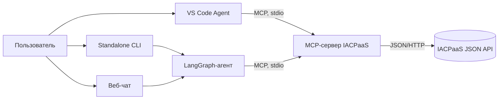
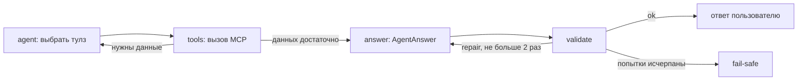

# Архитектура

Прототип состоит из MCP-сервера-адаптера к IACPaaS и агента, который отвечает
только по результатам вызовов этого сервера.

## Режимы

- **VS Code** — MCP-сервер подключается из `.vscode/mcp.json`, поведение задает
  `.github/agents/iacpaas.agent.md`. Доступны только read-only тулзы.
- **Standalone CLI** — `iacpaas-agent`: LangGraph-цикл, структурированный ответ,
  детерминированная проверка.
- **Веб-чат** — `iacpaas-web`: FastAPI и одна HTML-страница, тот же `run_agent`
  в read-only режиме. В модель передаются последние 3 хода; evidence прошлых
  вызовов добавляется в общий пул с ID `h1_...`, `h2_...`.

## Цикл агента

Состояние графа: вопрос, история, сообщения, `evidence` (`call_id -> результат`;
включая прошлые ходы), журнал вызовов, ответ, вердикт, число попыток и шагов.
Лимиты: 8 шагов сбора данных, 3 попытки ответа (первичная и две починки).

## Модули

| Модуль | Назначение |
|---|---|
| `src/iacpaas_mcp/server.py` | MCP-тулзы, проверки ошибок, каталог, подтверждение записи |
| `src/iacpaas_mcp/client.py` | HTTP-адаптер к IACPaaS, авторизация, `ErrorResult` |
| `src/iacpaas_mcp/models.py` | Pydantic-модели входов/выходов тулзов |
| `src/iacpaas_mcp/config.py` | константы, базовый URL и секреты из окружения |
| `src/iacpaas_agent/agent.py` | LangGraph-цикл, обертки MCP-тулзов, модель |
| `src/iacpaas_agent/schemas.py` | `AgentAnswer`, `Claim`, `Source` |
| `src/iacpaas_agent/validator.py` | детерминированная проверка ответа |
| `src/iacpaas_agent/prompts.py` | промпты и `PROMPT_VERSION` |
| `src/iacpaas_web/app.py` | FastAPI: чат, каталог, health |
| `src/iacpaas_web/index.html` | разметка чата |
| `src/iacpaas_web/static/style.css` | темная тема |
| `src/iacpaas_web/static/app.js` | логика чата и источники |

## Гарантии и границы

- Каждое утверждение в `AgentAnswer.claims` имеет источник: `call_id` и JSON Pointer.
- Валидатор проверяет существование источника, указателя, значения, формулу и
  отсутствие ответа без вызовов тулзов. Для текстового факта нужен точный `value`
  или дословная `quote`; без них claim отклоняется.
- `temperature=0` снижает разброс, но гарантию дает только валидатор.
- «Без внутренних знаний» означает: нет подтвержденного источника — нет утверждения
  в `claims`. Свободный текст `answer` валидатором не проверяется.
- В режиме VS Code детерминированного валидатора нет: там работают только
  инструкции агенту и read-only набор тулзов.
- Веб-чат тоже read-only, без авторизации пользователей и без серверной БД;
  история последних 3 ходов приходит с клиента.
- Сжатие ответов и автотесты отложены до v2.
