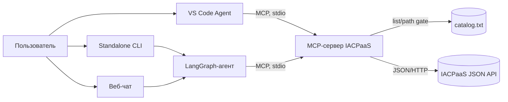
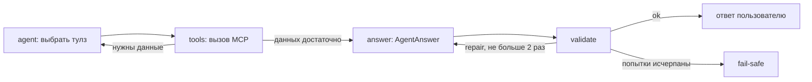

# Архитектура

Прототип состоит из MCP-сервера-адаптера к IACPaaS и агента, который отвечает
только по результатам вызовов этого сервера.

## Режимы

- **VS Code** - MCP-сервер подключается из `.vscode/mcp.json`, поведение задает
  `.github/agents/iacpaas.agent.md`. Доступны только read-only тулзы и
  `validate_answer`; сервер хранит evidence чтений в рамках MCP-процесса.
  Preview- и apply-тулзы в VS Code не входят в набор агента, поэтому write-операции
  там недоступны: они выполняются только в веб-чате после подтверждения плана.
  По инструкции агент должен вызвать проверку перед финальным ответом, но вызов
  остается на усмотрение модели.
- **Standalone CLI** - `iacpaas-agent`: LangGraph-цикл, структурированный ответ,
  детерминированная проверка.
- **Веб-чат** - `iacpaas-web`: FastAPI и одна HTML-страница, тот же `run_agent`
  с read- и preview-тулзами. Мутации разрешены только при `IACPAAS_ALLOW_WRITE=true`
  и после подтверждения плана. Все чаты и ходы хранятся в SQLite; evidence прошлых
  вызовов добавляется в пул с ID `m{message_id}_...`; трасса tool calls сохраняется
  в `messages.calls` и доступна в «Технических деталях» для ответов с claims.
  `AgentRuntime` создает один MCP-клиент в `lifespan` и кэширует наборы тулзов;
  CLI по-прежнему запускает MCP на один вызов.

## Цикл агента

Состояние графа: вопрос, история (в веб-чате - из SQLite), сообщения, `evidence`
(`call_id -> результат`; только ходы, поместившиеся в бюджет), журнал вызовов, ответ,
вердикт, число попыток и шагов.
Контекст задается `IACPAAS_AGENT_CONTEXT_TOKENS` (по умолчанию 1 млн). Лимиты
в символах считаются приблизительно: промпт — `(токены - 8000) * 3 * 0.8`,
история — 75% от лимита промпта. 8 шагов сбора данных, 3 попытки ответа
(первичная и две починки).

## Модули

| Модуль | Назначение |
|---|---|
| `src/iacpaas_mcp/server.py` | MCP-тулзы, проверки ошибок, подтверждение записи |
| `src/iacpaas_mcp/catalog.py` | локальный `catalog.txt`: поиск, проверка и обновление |
| `src/iacpaas_mcp/client.py` | HTTP-адаптер к IACPaaS, авторизация, `ErrorResult` |
| `src/iacpaas_mcp/models.py` | Pydantic-модели входов/выходов тулзов |
| `catalog.txt` | список доступных ресурсов: один `path` на строку |
| `src/iacpaas_mcp/config.py` | константы, базовый URL, секреты из `.env`/окружения |
| `src/iacpaas_agent/agent.py` | LangGraph-цикл, обертки MCP-тулзов, модель |
| `src/iacpaas_agent/schemas.py` | `AgentAnswer`, `Claim`, `Source` |
| `src/iacpaas_agent/validator.py` | детерминированная проверка ответа |
| `src/iacpaas_agent/prompts.py` | промпты агента |
| `src/iacpaas_web/app.py` | FastAPI: чат, сессии, health |
| `src/iacpaas_web/store.py` | SQLite: чаты и все ходы без удаления |
| `src/iacpaas_web/index.html` | разметка чата |
| `src/iacpaas_web/static/style.css` | темная тема |
| `src/iacpaas_web/static/app.js` | логика чата и источники |

## Гарантии и границы

- Каждое утверждение в `AgentAnswer.claims` имеет источник: `call_id` и JSON Pointer.
- Валидатор проверяет существование источника, указателя и точного значения или
  цитаты, а также отсутствие ответа без вызовов тулзов. В `claims` допускаются
  только прямые данные из результатов тулзов; суммы, средние и другие вычисленные
  значения в `claims` не входят и валидатором не проверяются.
- Битый JSON или несовпадение схемы `AgentAnswer` не роняют запрос: они дают
  причину для repair; после трех попыток выдается fail-safe.
- `temperature` задается `IACPAAS_AGENT_TEMPERATURE` (по умолчанию `0`; пусто -
  не передавать). `reasoning_effort` передается только если задан.
- Prompt caching: системный промпт и история идут первыми, новый вопрос - в конце;
  evidence передается в answer-промпт. Явный `cache_control` не используется.
- «Без внутренних знаний» означает: нет подтвержденного источника - нет утверждения
  в `claims`. Свободный текст `answer` валидатором не проверяется.
- В режиме VS Code валидатор вызывается отдельным тулзом `validate_answer`, но
  custom agent не принуждает модель к вызову. Гарантия появляется только в
  режимах, где completion tool нельзя обойти.
- Веб-чат без авторизации пользователей. Preview-тулзы доступны, но мутации
  разрешены только при `IACPAAS_ALLOW_WRITE=true` и `confirm=true` после
  подтверждения плана. Все чаты и ходы хранятся в `data/chat.db` и не удаляются;
  в модель уходят только ходы в пределах лимита истории, отказы и fail-safe в контекст
  не включаются; исключение - refused-ход с preview-вызовом, нужный для подтверждения.
- Сжатие ответов и автотесты отложены до v2.
